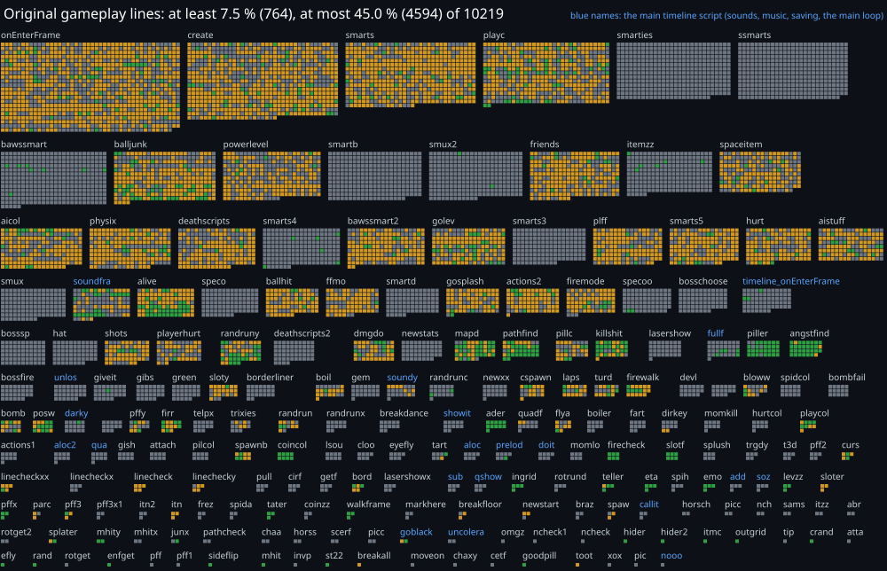

<p align="center">
  
</p>

<h1 align="center">OpenTBOI</h1>

An open-source engine, written in Rust, that plays the original *The Binding of Isaac* (the 2011
Flash game, Steam AppID 113200). It contains **no game assets**: art, sounds and room layouts are
read from **your own copy** of the game when you first start it.

> **Status: early.** Movement, shooting, bombs, pickups, cards, pills, shops, gambling machines,
> doors, floor generation, the HUD, the Basement's music and most of the Basement's enemies work.
> Bosses, most items, trinkets and everything after the first chapter are not done yet, so there is
> no complete run. See [`VERIFIED.md`](VERIFIED.md) for what has been checked,
> [`TODO.md`](TODO.md) for what is missing, and [how much of the original is ported](#how-much-of-the-original-is-ported)
> below.

## What you need

1. **The Binding of Isaac** (not *Rebirth*, not *Repentance*), installed from
   [Steam](https://store.steampowered.com/app/113200/The_Binding_of_Isaac/) (the
   [Humble Store](https://www.humblebundle.com/store/the-binding-of-isaac-wrath-of-the-lamb-dlc) sells it too). This is the only
   source of the art and sound; without it the game says it cannot find its files.
   - On Linux and SteamOS the Steam build is a Windows program. Steam installs it through
     Proton ("Steam Play"), which Steam turns on by default for games without a native Linux build
     (since June 2025). OpenTBOI never runs the original; it only reads its files, so you only need
     it *installed*.
   - Steam libraries are found automatically (native, Flatpak and Snap Steam, and extra library
     folders). To point at another folder, set `TBOI_GAME_DIR=/path/to/The\ Binding\ Of\ Isaac`.
2. A computer with working graphics drivers (Vulkan or OpenGL) and, unless you use the portable
   tarball, SDL3 (see below). Old hardware is a goal: the baseline build needs only a 64-bit x86
   CPU with SSE2 (anything since 2003), nothing newer.

Nothing from the game is copied into this repository or into any release. The extracted copies live
in your own cache (`~/.cache/opentboi` on Linux) and can be deleted at any time.

## Install (Linux)

Download `opentboi-VERSION-linux-x86_64.tar.zst` from the releases page, then:

```sh
tar --zstd -xf opentboi-*-linux-x86_64.tar.zst
cd opentboi-*/ && ./install.sh
```

That needs no root: it copies the program, a launcher entry and an icon under `~/.local`, so it
works on immutable systems such as SteamOS and Bazzite too (Desktop Mode: open a terminal in the
unpacked folder). `./install.sh --uninstall` removes it again. The launcher then appears in your
application menu, and on a Steam Deck you can add it to Steam through "Add a Non-Steam Game".

Supported systems are the ones their vendors still support (no end-of-life distributions); see
[`docs/distribution-options.md`](docs/distribution-options.md) for the policy and for the
Flatpak and distribution-package plans. Windows and macOS packages do not exist yet.

## Build from source

This always works and is the reference path: packages are built from exactly this.

Install [rustup](https://rustup.rs); the project pins its Rust version in `rust-toolchain.toml` (with
Clippy and rustfmt), and `rustup toolchain install` in the checkout fetches exactly that one. Then
the development packages for SDL3 (the default frontend), ALSA and udev. On Fedora:

```sh
sudo dnf install SDL3-devel alsa-lib-devel systemd-devel
cargo run --release
```

Where the distribution has no SDL3 package (Ubuntu 24.04, Debian 12), let cargo build SDL3 and link
it statically. That needs `cmake`, `make` and a C compiler (no C++ compiler) plus the X11/Wayland
development packages SDL asks for, then `cargo run --release --features bundled-sdl3`.
On Fedora (tested in a Fedora 44 container):

```sh
sudo dnf install cmake make gcc alsa-lib-devel systemd-devel wayland-devel wayland-protocols-devel \
  libxkbcommon-devel libX11-devel libXext-devel libXcursor-devel libXi-devel libXrandr-devel \
  libXfixes-devel libXScrnSaver-devel libXtst-devel libdecor-devel mesa-libEGL-devel \
  mesa-libgbm-devel libdrm-devel mesa-libGL-devel pipewire-devel pulseaudio-libs-devel dbus-devel
```

Without the window-system packages SDL's configure step stops with an error instead of building a
binary that cannot open a window.
The Windows and macOS builds have not been tried yet.

On an immutable system (Bazzite, SteamOS, Fedora Silverblue) the packages go into a container
instead of the host: with [distrobox](https://distrobox.it) and [mise](https://mise.jdx.dev),

```sh
mise trust            # once, for this checkout's mise.toml
mise run dev-box      # creates the Fedora container from distrobox.ini
mise run run          # builds and starts the game; `mise tasks` lists the others
```

The tasks run in that container when it exists and on the host otherwise, so they work the same
on a Fedora workstation with the packages above.

A second frontend based on Bevy is available as a feature: `cargo run --release --no-default-features
--features bevy-frontend`, or build both with `--all-features` and pick one with `--frontend`.

`cargo run --release -- --help` lists the options (window size, fullscreen, seed, tick rate,
original-versus-Rebirth behaviour choices and more).

## Controls

| | Keyboard and mouse | Gamepad |
|---|---|---|
| Move | `W` `A` `S` `D` | left stick or D-pad |
| Shoot | arrow keys, or hold the mouse button | right stick or face buttons |
| Bomb | `E` | left shoulder |
| Card | `Q` | right shoulder |
| Restart run (hold) | `R` | right stick press plus right trigger |
| Skip intro / answer "Replay?" | `Space` | south button |
| Fullscreen | `F11` | Back / Select |
| Quit | `Esc` | Start |

The mouse cursor hides while a gamepad is the device in use and comes back when the mouse moves.

Gamepads that SDL reports as gamepads (Xbox, PlayStation, Switch pads, the Steam Deck's controls)
work as they are. The original Steam Controller (2015) is different: with Steam running, programs
started outside Steam see it only as a keyboard and a mouse, so add OpenTBOI to Steam ("Add a
Non-Steam Game") and let Steam Input present it as a gamepad.

## How much of the original is ported

The original's logic is one big script (plus a smaller one on the main timeline for sounds, music
and saving). `scripts/original-coverage.py` counts how many of its gameplay lines our sources cite
(`DoAction N` or `Timeline N` in a comment) or reproduce, and draws the result as a map: one square
per line, one block per function, green where the line is ported, amber where only the function is
named, grey where nothing is.

[](docs/original-coverage-map.svg)

The map holds function names and counts only, none of the original's code, and `cargo build` redraws it
when the original's scripts are in your cache. [`docs/original-coverage.md`](docs/original-coverage.md)
explains what the numbers do and do not prove. The figure is evidence of a port, not proof of one.

### Functions ported completely

These original functions have every gameplay line cited or reproduced in our sources (a green square
for each line on the map). What each one does, in short:

**The room's grid and what stands in it**
- `ingrid()` / `outgrid()`: turn a point in the room into the number of its grid cell, and a cell back
  into the point at its centre.
- `levzz()`: reads what the room's grid holds at a cell; for enemies, a doorway reads as a shut door.
- `mhit()` / `mhity()`: whether a point is blocked for something walking, or for a tear (tears fly over
  pits).
- `enfget()`: the length of a vector, never quite zero.
- `crand()`: a random point on a circle of a given radius, one coordinate per call.
- `rand()`: a random number between -0.5 and 0.5.
- `posw()` / `spaw()`: find a free tile near a point (growing the search circle, avoiding rocks, marks
  and pickups, and, in the challenge room, other things and Isaac), mark it as given away, and put
  what is being created there.
- `firecheck()`: Isaac's four corners against a burning fireplace: it pushes him away, and it hurts him.
- `pffx()`: the floor generator's test for whether a cell may join the floor.

**Pickups, pills and cards**
- `pillc()`: taking a card, pill or trinket: names it, swaps it for the one held (which is put down),
  and keeps the Tick in the first slot.
- `piller()`: gives a pill look its effect the first time, rolling a chain of odds that Isaac's health,
  bombs, keys, the Lucky Foot and PHD change.
- `tater()`: a random card (a playing card one time in five).
- `coincol()`: what a coin is worth (1, 5 or 10) and its sound and message.
- `emo()` / `goodpill()`: Isaac's thumbs-up or thumbs-down and the sound of a good pill.
- `st22()`: shows a short message at the top right.
- `eta()`: toggles an eternal heart, and two of them make a heart container.
- `itzz()`: tells minor items from major ones.
- `slotf()`: rolls the slot machine's result (the Lucky Foot trims the top of it).
- `ader()`: paying blood to a machine: half a heart of damage, taken from the red hearts before the
  soul hearts.

**Creatures and drawing**
- `efly()`: the fly that circles a corny poop.
- `walkframe()`: a walking creature's clip switches between standing and walking by its speed.
- `sideflip()`: turns a clip around when it moves against its facing.

**Map and secret rooms**
- `itmc()`: the minimap's mark for what is left in a room.
- `hider()` / `hider2()`: the jingle of finding a secret room, once.

A further set of functions is ported, but not every line is individually cited yet (`teller()`,
`playcol()`, `linecheck()`, `linecheckxx()`, `firr()`, `toot()`, `splater()`, `curs()`, `spawnb()`,
`pff3()`, `itn()`, `firewalk()`, `angstfind()`, `breakall()`, `bord()`, `goblack()`, `sloter()`). The
map shows them amber.

## Development

[`AGENTS.md`](AGENTS.md) describes the layout and conventions (it doubles as the notes for AI
coding assistants). In short: `src/game/` holds the engine-independent rules, `src/frontend/` the
engine code, `src/game_assets/` the extraction from the user's install. Before sending a change,
run `cargo fmt`, `cargo clippy --all-targets --all-features` and `cargo test`.

`THIRD-PARTY-LICENSES` is not stored in the repository: `build.rs` generates it with
[`cargo-about`](https://github.com/EmbarkStudios/cargo-about) whenever `Cargo.lock` changes, and
every release carries it. You don't need the tool to build or contribute: without it the build
prints a warning and goes on. Install it once with `cargo install cargo-about --locked --features cli`
if you want the file, and set `OPENTBOI_REQUIRE_LICENSES=1` to make a missing tool an error (the
release job does).

Never commit the original's files (any `.swf` is git-ignored) or text taken from them.

Changes come as pull requests. Title one with its kind and a colon: `breaking:`, `feature:`, `fix:`
or `chore:` (for example `fix: boss door stays shut`); a check enforces it, since the squashed commit
takes the title and the release version is worked out from those titles (`breaking` is the next major
version, or minor while it is 0, `feature` the next minor, `fix` the next patch, `chore` alone makes no
release). CI also needs `cargo fmt`, Clippy without warnings and the tests to pass.

## Licence

OpenTBOI is free software: you can redistribute it and modify it under the terms of the
[GNU General Public License](LICENSE), version 3 or (at your option) any later version. The
libraries it is built from keep their own licences, listed in
`THIRD-PARTY-LICENSES` (in every release; see Development); [Ruffle](https://ruffle.rs) (MIT or Apache-2.0)
provides the SWF parser and shape tessellator.

## Not affiliated

*The Binding of Isaac* and its art, music and characters belong to their respective owners (Edmund
McMillen, Florian Himsl, Nicalis, Inc. and others). OpenTBOI is an independent fan project. It is
not made, endorsed or supported by them, and it does not include or distribute their work. Buy the
game to play with it.
